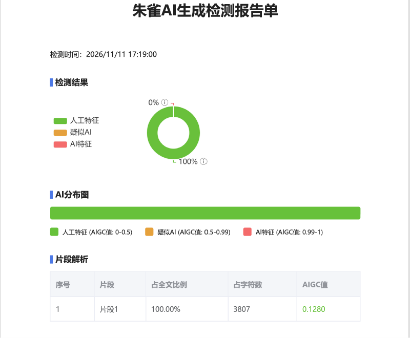

# 人味 Renwei · 中文写作去 AI 味

**把 AI 写的中文，改成读起来像人写的。** 不是把句子改漂亮，是把"效率"降下来。

`62 项机械自检` · `三档文体自适应` · `可用自己的稿子校准阈值` · `主检测零依赖`

---

##如下AI检测基于模型：glm5.3flash-low与本skill的网络小说版本测得，网络小说版本将在完善后开源。如下readme.md看起来不像人写的，我要懒得改了。先将计就计吧。

## 一句话原理

> AI 的每个字都在工作；所以"去 AI 味"不可以只是润色，更重要的是要**降效率**：凡是把每一句都磨亮的动作，方向都是错的。

## 它到底在治什么

读完一段文字觉得"像 AI"，通常是这六件事同时成立：

| 症状 | 长相 |
|---|---|
| 句长匀速 | 每句都在 20 字上下，读十句没有一次换气 |
| 段落等长 | 每段三句，每节三点，首尾还呼应 |
| 术语空转 | 赋能、抓手、闭环、维度、底层逻辑，一个都不指向具体事物 |
| 细节贴图 | 细节一段一个摆过去，摆完文章就停了 |
| 数字当纹饰 | `9:07`、`四分钟`、`三十七行`，后文一次不用 |
| 结尾升华 | "愿每一个努力的人都被看见""未来可期" |

这套 skill 把上面六件事拆成 62 个可机械判定的项目，同时补上了一层机检测不出来的东西（判断、处境、跑题、不解释）。

## 实测：朱雀检测

同一套判定逻辑下，改写稿在腾讯朱雀的实测（网文验证章，AI 特征均为 0）：


| 章 | 形态 | 人工特征 | 疑似 AI | AI 特征 | 机检 |
|---|---|---|---|---|---|
| 050 | 情感送别 / 低事件流程戏 | **100%** | **0%** | **0%** | FAIL=0，spo 67.8% |
| 058 | 低事件过渡章 | 85.02% | 14.98% | 0% | FAIL=0，spo 72.7% |
| 038 | 群像对峙复盘会 | 100% | 0% | 0% | FAIL=0，spo 71.8% |


<details>
<summary>另一章实测截图（058，低事件过渡章：人工 85.02%，AI 特征 0%）</summary>




</details>

## 六个优势

**1. 阈值有人类基线，不是拍脑袋**
11 部中文叙事作品、24 份切片、约 23 万字，取 P25 / P75 定带，验收带用 `[P25−0.5×IQR, P75+0.5×IQR]`。每个数字都能追到`references/01-基线与定档.md`。

**2. 可以用你自己的文章校准**
默认值只是起点。使用时推进放 3-5 篇同体裁的人类文章进一个目录：

```bash
python scripts/lint.py --calibrate 我的语料/ --genre args --save-profile my.json
python scripts/lint.py 待改稿.md --profile my.json
```

有效样本不足 3 篇时脚本直接拒绝；总量不足 5000 字会警告分位数不稳——小样本上算出来的"阈值"只适合那一篇稿子。

**3. 三档文体，尺子不一样**

| 档 | 文体 | 主要看什么 |
|---|---|---|
| `narr` | 随笔、特写、纪实、公众号叙事 | 句长变异、段落呼吸、细节密度 |
| `args` | 评论、分析、报告、方案、演讲稿 | 论证词、抽象名词、对仗与排比 |
| `offi` | 通知、总结、请示、纪要 | 只查腔调，不查节奏 |

同一条规则在三档里方向可能相反。**先定档，再改字**；拿错尺子会越改越假。

**4. 两头都管：既防"电报体"，也防"过度完整"**
`spo_check.py` 查主谓宾完整句占比，人类带 60.8%–75.1%（中位 68）。低于 60 是断片，高于 90 是另一种机器味——所以它是带状验收，不是越高越好。

**5. 明确反对"指标 KPI"**
这是本仓库最反直觉的一条，也是最贵的教训。同一篇稿子改八版、指标越调越漂亮、判分反而崩：

| 版本 | 人工特征 | 句长 SD | 状态 |
|---|---|---|---|
| v14 | **43.11** | 14.3 | 有毛边 |
| v16 | **21.52** | 14.3 | 全部检查 PASS |

v16 把句长 SD 拉到位、把字句从 87 压到 9.4、虚词全部补进区间——**29 项全 PASS，判得最惨**。原因写在 `references/04-指标反噬实录.md`：为了"理顺段落"，把大量直接引语并成了转述。句子漂亮了，人没了。

**6. 零依赖、可离线、能进流水线**
`lint.py` 只用标准库；`spo_check.py` 可选（需 `jieba`）。两个脚本都不联网，可以挂在 CI 或写作流水线里跑。

## 五步工作流

| 步 | 做什么 |
|---|---|
| 0 定档 | 判 `narr`/`args`/`offi`；有同体裁样本先 `--calibrate` |
| 1 手感 | 从人类文章各抽 2000-3000 字，抄最长句/最短句、数每段几句，产 5-8 行备忘贴稿头 |
| 2 机检 | `python scripts/lint.py 稿.md --genre args`，列 FAIL |
| 3 改写 | FAIL 清零 → 语用与人味（每 3000 字挑 4-6 条）→ 开头/结尾/段落呼吸 → 细节、数字、对话 |
| 4 复测 | FAIL=0；spo 落 70-90%；七问自检全过 |
| 5 人读 | 从后往前读一遍，读不出"作者在展示手艺"才算过 |

## 改写长什么样

原文（典型 AI 稿）：

> 在当今快速迭代的市场环境中，这款产品的定位既清晰又模糊。它不仅解决了用户的核心痛点，更重新定义了行业标准。值得注意的是，其底层逻辑在于以场景为抓手，构建完整的生态闭环。总而言之，这是一次值得肯定的尝试，未来可期。

改后：

> 这款产品的定位有点别扭：说它是工具，它偏要做平台；说它是平台，能用的只有三个功能。
>
> 我用了两周。真正省事的只有一处——把原来要跳三次的流程压成一次。剩下的"生态"，我没找到入口。
>
> 至于行业标准，我没资格评判。只知道上次开会，隔壁组还在用老办法，也没人觉得慢。

动了什么：删背景套话与"不仅…更"（AI 第一高频句式）、删"值得注意的是/总而言之"、删"未来可期"（末段升华）；把四个抽象词落地成三个具体动作；留一处"我没资格评判"（可被反驳的判断）和一句跑题。完整三段示范见 `references/05-改写对照.md`。

## 目录结构

```
renwei/
├── SKILL.md                 # 技能入口：何时用、三档、五步流水线
├── CORE.md                  # 唯一执行表：纪律 · 机械层速查 · 写作层 · 七问 · 验收
├── references/
│   ├── 01-基线与定档.md      # 阈值从哪来、三档默认值、怎么校准
│   ├── 02-AI味指纹图谱.md    # 六层病因诊断
│   ├── 03-叙述七病.md        # 词句都干净后剩下的七种病
│   ├── 04-指标反噬实录.md    # 指标全绿反而更假的实测记录
│   └── 05-改写对照.md        # args / narr / offi 三段逐段改写
├── scripts/
│   ├── lint.py              # 62 项机检，三档内置 + 样本校准
│   └── spo_check.py         # 主谓宾完整句占比（防断片）
└── images/                  # README 用截图
```

安装：把 `renwei/` 放进 `~/.workbuddy/skills/` 或项目的 `.workbuddy/skills/`，然后在对话里说"帮我去一下 AI 味"即可触发。

## 适用与不适用

**适用**：公众号、评论、随笔、报告、方案、总结、演讲稿、邮件、产品文案、人物特写、纪实。

**不适用**：诗歌、歌词；以及"格式即内容"的部分——红头通知的版式、合同条款、法定文书，本 skill 不改这些。

## 三条设计原则

1. **只排雷，不配方。** 指标是下限，人味是上限。拿上限去换下限，越改越差。
2. **指标缺失不补。** 为了凑数字写进去的句子，一定看得出来。
3. **目标是像人，不是骗过检测器。** 检测器只作旁证，人读一票否决。

## 已知局限

- 基线语料是叙事文体：句长、段长、虚词密度这些**语言底层指标**可迁移；人名密度、对话占比这类**内容指标**不可迁移，已删除或降级为门槛。
- `args` / `offi` 两档多数项属**经验档**，未经大样本量化，**用前必须用自己的样本校准**。
- 公文档只筛腔调，不对格式提任何要求。

## 许可

本仓库暂未附许可证文件。如需商用、二次分发或上架技能市场，请先联系作者。检测截图中的"朱雀"为腾讯旗下第三方检测工具，仅作旁证引用。

> 上传技能市场打包时，请排除 `README.md` 与 `images/`——SKILL.md 才是技能定义，其余是给人看的。
